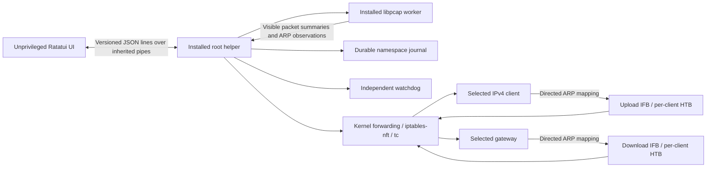

# Runtime and traffic path

The controller is on the same Ethernet-compatible LAN as the client and gateway. ARP requests and replies are directed only to those endpoints. This is neither a switch mirror nor a router QoS API. Static neighbor entries, client isolation and anti-spoofing can prevent the path. Traffic verification remains idle until matching forwarding and finite-policy class counters increase. IPv6 and direct LAN traffic are outside enforcement.

## Processes and dependencies

`netctrl-core` contains portable DTOs, validation and algorithms. `netctrl-engine` defines the wire protocol; its framing is bounded to 1 MiB and rejects unknown protocol versions. `netctrl-sim` implements shared discovery, capture, ARP, forwarding and shaping contracts deterministically. Linux discovery and class readback use asynchronous Netlink. The Linux helper owns synchronous system-tool transactions and runs the capture worker. Only the worker links libpcap. The UI links no native packet-capture library and receives no packet payloads.

The application never restores Manage merely because it was saved. Prepare independently validates current interface, route and neighbor identities. A revision with a 60-second lifetime binds Apply to the displayed plan. Finite limits are 1,000..10^12 bps; Linux rounds to integer bytes/sec (at most 7 bps downward). Unlimited omits the shaping classifier in that direction. Zero is rejected.

## Installation and verification

The helper and worker are built as a normal user and installed root-owned in `/usr/local/libexec/netctrl`. The UI uses sudo only for that installed helper. Tool paths come from a fixed allowlist and arguments are separate strings. Installed executable ancestry must be root-owned and not writable by other users.

For each plan the helper checks active Ethernet framing, all controller addresses, gateway identity, unique client identities, local subnet containment and selected default route. It refuses foreign ingress filters and competing native nftables forwarding base chains. Queue installation preserves the physical root qdisc. Readback checks classifier cookies and inventory, owned firewall rules/hooks, IFB aliases, HTB rates/ceilings and forwarding state. Interface/neighbor/route validation repeats while enforcement is active; custom IPv4 routing rules are refused. Owned IFBs accept large packets until the kernel applies the physical egress or route MTU. Backend installation and observed use are separate statuses.

## Transactions and recovery

`/var/lib/netctrl/session-<network-namespace-inode>.json` is a root-owned, mode-0600 journal. A namespace file lock serializes session setup and recovery. Every mutation is preceded by a durable journal update. IFB aliases, classifier cookies and firewall comments bind objects to a random 128-bit session token. The journal records the previous per-interface forwarding value.

Recovery removes owned ingress redirection, repairs endpoint ARP mappings while forwarding remains enabled briefly, removes owned queues and scoped firewall rules, then restores forwarding. Exact rule readback detects changes during enforcement. Cleanup checks ownership again, preserves foreign objects and retains the journal with explicit conflict diagnostics. Repeating recovery is safe. Externally removing a whole object is tolerated; inserting foreign rules into an owned chain requires administrative inspection.

A separate watchdog inherits only a heartbeat pipe and the network namespace. A startup handshake authenticates its direct helper parent. It verifies the helper's PID plus process start time before terminating a stalled helper. UI request silence is bounded at five seconds; the watchdog heartbeat deadline is six seconds. Successful cleanup explicitly disarms it. Power loss prevents immediate remote ARP repair; remote caches may need expiry or manual refresh.

## Tests

Workspace tests cover validation, registry reconciliation and conflicts, rates, bounded history, token buckets, wire framing rejection, ARP/header truncation, IPv6 parsing, duplicate-forward observation, simulator failures, TUI confirmation and terminal restoration. `netctrl-lab` is a separate root-only executable that creates only isolated test links/namespaces. It exercises real helper/worker IPC, firewall/ingress conflicts, rollback, independent client queues, unlimited directions, TCP and UDP, fragments, mapping changes, normal exit, helper SIGKILL and UI heartbeat loss.

Rust UDP measurement processes offer three times each finite cap. The receiver discards a one-second warm-up and measures six seconds of payload bytes. Each direction must deliver 75–110% of its configured cap. IP and Ethernet overhead explain payload throughput near 96% of an IP-oriented cap. Missing prerequisites fail the test explicitly. Ubuntu 22.04 and 24.04 run the same lab in CI.

References: [Linux forwarding](https://docs.kernel.org/networking/ip-sysctl.html), [IFB redirection](https://man7.org/linux/man-pages/man8/tc-mirred.8.html), [HTB](https://man7.org/linux/man-pages/man8/tc-htb.8.html).
